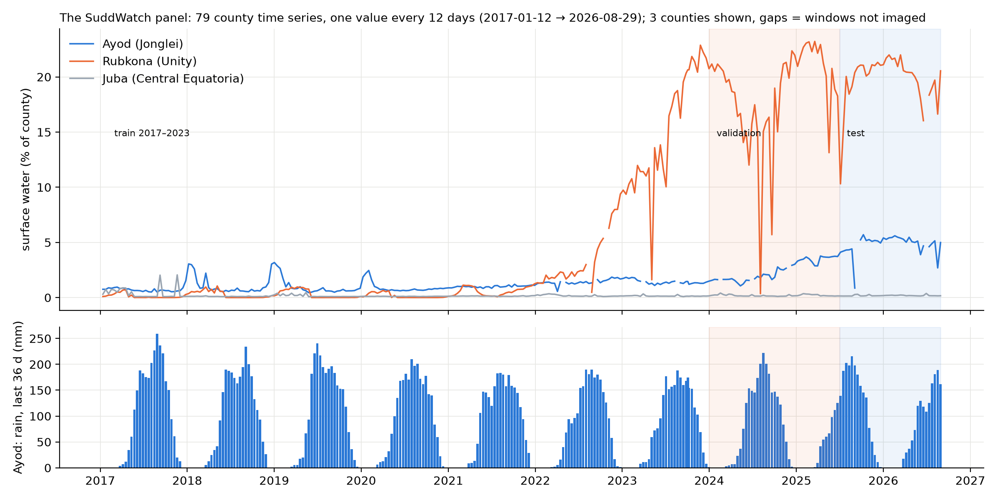

# SuddWatch — County-Level Flood-Risk Forecasting for South Sudan's Sudd Wetlands

Author: Jok Akech Atem Mabior · Repository: https://github.com/Super-Talen/SuddWatch

| | |
|---|---|
| **Task type** | **Binary Classification** on a **panel time series** (supervised, short-horizon forecasting) |
| **Data structure** | **Panel time series**: 79 counties × 295 time steps (one every 12 days), long format — see [`data/README.md`](data/README.md) |
| **Unit of analysis** | one row = one South Sudan county at one point in time (one 12-day Sentinel-1 window) |
| **Target (Y)** | `y_flood_2_4wk` = 1 if the county's surface-water fraction 13–24 days after the issue date exceeds that county's own 75th percentile (computed on training years only) |
| **Dataset size** | **N = 23,305 rows × P = 26 columns** (20 candidate features + identifiers, split tag and target) |
| **Period** | issue windows 2017-01-12 → 2026-08-29 · 79 counties (COD-AB admin2) |
| **SDGs** | SDG 13 (Climate Action) — linked to SDG 2 (Zero Hunger), SDG 1 (No Poverty) |

<!-- PANEL-TIME-SERIES:START (generated by src/data_card.py) -->
## About the data: a panel time series

> **This dataset is a panel time series.** Each of South Sudan's **79 counties** is observed **every 12 days** (one Sentinel-1
> satellite revisit window) from **2017-01-12 to 2026-08-29**: **295 time steps per county, 23,305 rows × 26 columns**. It is stored in
> *long format*, one row per county per time step, so it looks like an ordinary table, but every county is a time series and the
> rows are linked through time.



```
                 time  →   window 1     window 2     ...   window 295
                           2017-01-12   2017-01-24         2026-08-29
 county  Ayod   (SS0302)   row          row          ...   row
    ↓    Duk    (SS0305)   row          row          ...   row
         ...               ...          ...          ...   ...
         Juba   (SS0101)   row          row          ...   row
                           = 79 counties × 295 windows = 23,305 rows   (balanced panel)
```

| How the time dimension is used | Where |
|---|---|
| **Lagged values** of each county's series | `water_frac_lag1` (t − 1), `water_frac_lag2` (t − 2); Phase 2 adds the change `water_frac − water_frac_lag1` |
| **Look-back windows** of an external driver | rainfall over the 12, 36 and 90 days ending on the forecast date, and its anomaly vs 2001–2016 |
| **Target in the future** | `y_flood_2_4wk` is the county's water state **two windows ahead** (13–24 days after the forecast date) |
| **Seasonality** | `month`, encoded as sin/cos |
| **Chronological validation** | train 2017–2023 → validation 2024 – mid-2025 → test mid-2025 – 2026; no shuffling; `TimeSeriesSplit` with a 2-window gap |
| **Missingness over time** | the Sentinel-1B failure (Dec 2021) left some counties un-imaged until Sentinel-1C/D (mid-2025): diagnosed as MAR |
| **Drift over time** | exceedances rise after 2022 (e.g. Rubkona/Bentiu in the figure above) — Phase 2 report, Section V-C |

**Why forecasting is framed as classification on the panel.** Each county series is short (295 steps), has satellite gaps and is driven
by external factors (rainfall, terrain). Lag and look-back features plus a target two windows ahead let one gradient-boosted classifier learn
from all 79 series at once, a standard approach for panels of many short series; a sequence model (ConvLSTM) is planned as a baseline.

**Snapshot: one county through time** (Ayod, Jonglei; `water_frac_lag1` on each row is the previous row's `water_frac`)

| adm2_name | adm1_name | issue_date | obs_frac | water_frac | water_frac_lag1 | rain_36d_mm | rain_90d_anom_mm | month | y_flood_2_4wk |
|---|---|---|---|---|---|---|---|---|---|
| Ayod | Jonglei | 2024-07-10 | 1 | 0.0171 |  | 145.3 | -7.23 | 7 | 1 |
| Ayod | Jonglei | 2024-07-22 | 1 | 0.0193 | 0.0171 | 174 | 10.26 | 7 | 1 |
| Ayod | Jonglei | 2024-08-03 | 1 | 0.0179 | 0.0193 | 201.3 | 20.56 | 8 | 1 |
| Ayod | Jonglei | 2024-08-15 | 1 | 0.0212 | 0.0179 | 222.3 | 47.38 | 8 | 1 |
| Ayod | Jonglei | 2024-08-27 | 1 | 0.0208 | 0.0212 | 201 | 11.49 | 8 | 1 |

Full data dictionary, more snapshots and descriptive statistics for every column: **[`data/README.md`](data/README.md)** ·
one county's complete series as a table: [`data/sample_ayod_county_timeseries.csv`](data/sample_ayod_county_timeseries.csv)
<!-- PANEL-TIME-SERIES:END -->

## 1. Problem statement

Recurrent flooding in the Sudd wetlands now multiplies South Sudan's hunger and displacement crises.
By October 2025 floods affected over one million people in 29 counties, 87 % of them in Jonglei and
Unity, repeatedly cutting food access to famine-risk counties such as Nasir and Fangak. Existing
satellite products map flood extent *after* it happens or forecast regional extent months ahead; none
tells humanitarian planners **which county will flood in the next 2–4 weeks**, which is the lead time
needed to pre-position food, medicine and boats before roads and river routes close.

SuddWatch learns, from ten years of Sentinel-1 radar flood history, rainfall and terrain, to predict
whether each county's surface-water extent will exceed its own normal high-water level 13–24 days
after the forecast is issued.

## 2. Dataset overview

Full dataset documentation — structure, column dictionary, row snapshots, descriptive statistics for every column and the source
files — is in **[`data/README.md`](data/README.md)**. One county's complete time series is browsable as a table in
[`data/sample_ayod_county_timeseries.csv`](data/sample_ayod_county_timeseries.csv).

| Source | Role | Access | Link |
|---|---|---|---|
| Copernicus **Sentinel-1** SAR GRD (VV, IW) | label source + autoregressive features (surface-water fraction per county per window) | Google Earth Engine `COPERNICUS/S1_GRD` | https://developers.google.com/earth-engine/datasets/catalog/COPERNICUS_S1_GRD |
| **CHIRPS** v2.0 daily rainfall | rainfall totals (12/36/90 days) and 90-day anomaly vs 2001–2016 | GEE `UCSB-CHG/CHIRPS/DAILY` | https://www.chc.ucsb.edu/data/chirps |
| **SRTM** 1-arc-second DEM | elevation mean/std, slope | GEE `USGS/SRTMGL1_003` | https://developers.google.com/earth-engine/datasets/catalog/USGS_SRTMGL1_003 |
| **MERIT Hydro** | height above nearest drainage (HAND), upstream area → topographic wetness index | GEE `MERIT/Hydro/v1_0_1` | https://developers.google.com/earth-engine/datasets/catalog/MERIT_Hydro_v1_0_1 |
| **JRC Global Surface Water** v1.4 | permanent-water share, long-term water occurrence | GEE `JRC/GSW1_4/GlobalSurfaceWater` | https://developers.google.com/earth-engine/datasets/catalog/JRC_GSW1_4_GlobalSurfaceWater |
| **COD-AB** South Sudan admin boundaries (OCHA) | 79 county polygons, join key `adm2_pcode` | HDX | https://data.humdata.org/dataset/cod-ab-ssd |
| **UNOSAT** VIIRS water extents 2022–2024 | *independent validation* of the Sentinel-1 label (not a model input) | HDX | https://data.humdata.org/dataset/satellite-detected-water-extents-between-20-and-24-april-2022-over-south-sudan |
| IOM DTM flood locations (2019) | reference only (downstream humanitarian cross-referencing) | HDX | https://data.humdata.org/dataset/south-sudan-flood-locations |

**Target definition and class balance.** Of 21,160 labelled rows, the positive class (Y=1) is 19.2% in train (4.21:1), 36.4% in validation and 36.8% in test. 2,145 rows have no label because the target window was not imaged by Sentinel-1 (MAR, acquisition plan); they are excluded from fitting, never imputed. Mitigation: `class_weight="balanced"`, validation-tuned decision threshold, PR-AUC/F1/recall metrics. Full audit: [`phase1_strategy/Phase1_Strategy_Report.pdf`](phase1_strategy/Phase1_Strategy_Report.pdf).

## 3. Reproduce

```bash
python -m venv .venv
.venv\Scripts\pip install -r requirements.txt          # Windows (use .venv/bin/pip on macOS/Linux)
.venv\Scripts\earthengine authenticate                  # one-time Google Earth Engine login
# edit PROJECT in src/gee_extract.py to your own registered Earth Engine Cloud project
.venv\Scripts\python -m src.gee_extract all             # ~1 h on the free Community tier; cached & resumable
.venv\Scripts\python -m src.build_panel                 # -> data/raw/suddwatch_panel_unprocessed.csv
.venv\Scripts\python -m src.audit                       # -> phase1_strategy/audit/*
.venv\Scripts\python -m src.label_sensitivity           # Phase 2 label check (Earth Engine, ~5 min)
.venv\Scripts\python -m jupyter nbconvert --to notebook --execute --inplace phase2_implementation/notebooks/pipeline_execution.ipynb
.venv\Scripts\python -m src.report_phase2               # -> phase2_implementation/Phase2_Final_Report.pdf
```

The UNOSAT GeoPackage (67 MB) is excluded from Git because of size; download it from the HDX link
above into `data/raw/` to re-run the label validation.

## 4. Pipeline summary (Phase 1 plan → Phase 2 implementation)

1. **Split first** (temporal): train = issue dates < 2024-01-01, validation = 2024-01-01 – 2025-06-30,
   test = 2025-07-01 – 2026-08-31 (covers the 2025 flood season). Inner tuning uses
   `TimeSeriesSplit` with a 2-window purge gap because Y looks two windows ahead.
2. **Impute** Sentinel-1 gaps (MAR — satellite acquisition plan) with county-level *training* medians
   plus missing-indicator flags.
3. **Cap** heavy-tailed features at training IQR fences (features only; labels are never capped).
4. **Transform & scale**: log1p + StandardScaler for right-skewed features, MinMax for [0,1] fractions,
   StandardScaler for symmetric ones; one-hot for the 11 states; sin/cos for month.
5. **Collinearity**: drop one feature of every pair with |Spearman ρ| ≥ 0.85 or VIF > 10 (keep the one
   with higher mutual information with Y).
6. **Model** (later assignments): gradient-boosted trees, logistic-regression baseline, `class_weight="balanced"`.

All fitted statistics live inside one scikit-learn `Pipeline` that is fitted on `X_train` only.

## 5. Phase 2 results (summary)

| | |
|---|---|
| Notebook | [`phase2_implementation/notebooks/pipeline_execution.ipynb`](phase2_implementation/notebooks/pipeline_execution.ipynb) — runs top to bottom; asserts the Phase 1 audit reproduces first |
| Report | [`phase2_implementation/Phase2_Final_Report.pdf`](phase2_implementation/Phase2_Final_Report.pdf) |
| Split after purge | train 15424 / validation 2792 / test 2662 rows (73.9 / 13.4 / 12.8 %) |
| Output | 23 features, 0 missing values, fitted on `X_train` only |
| Feature reduction | 34 → 23 features; baseline PR-AUC (temporal CV) 0.534 → 0.550, validation 0.831 → 0.833 — no information loss |
| PCA | 9 / 13 of 23 components for 90 % / 95 % variance (diagnostic only) |
| Carried to modelling | rising exceedance rate since 2022 (drift), VH −26 dB label variant, decision-threshold tuning |
