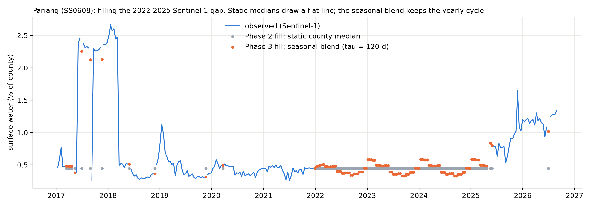
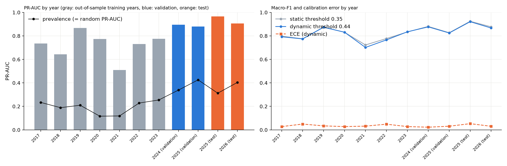

# Response to the Phase 2 Feedback

This document answers each point of the Phase 2 feedback with what was changed and the evidence for it. The graded
Phase 1 and Phase 2 deliverables are left exactly as submitted; all changes live in a Phase 3 layer
(`src/features_v2.py`, `src/pipeline_v2.py`, `src/train_model.py`) and every number below is generated by
`src/report_feedback.py` from the saved results.

**Summary.** The feedback improved the model. On validation (the data used for all decisions), gradient boosting
with the Phase 3 preprocessing reaches **PR-AUC 0.891**
against 0.856 with the Phase 2 preprocessing and
0.835 for a persistence baseline. On the held-out
test period (Jul 2025 - Aug 2026) the final model scores **PR-AUC 0.927, Macro-F1 0.888,
false-alarm rate 10.5%** (proposal target < 15%) and **ECE 0.031**.

---

## Weakness 1 — Target distribution shift (19.0% → 36.9%)

**Changes.**
* **Rolling 12-month baseline (recommendation A1).** `water_frac_12m_mean` is the trailing 30-window (360-day) mean of
  observed water fraction, computed from windows up to the issue date only; `water_frac_anomaly = water_frac − water_frac_12m_mean`.
  It is the single most informative feature on training rows (MI 0.126 vs 0.119 for `water_frac`).
  The 12-month mean itself is then dropped: `water_frac`, the mean and the anomaly are exactly linearly dependent (VIF infinite).
* **Threshold-relative water level.** The target is "water two windows ahead exceeds *this county's* training-period threshold", so the
  model now receives `water_ratio = water_frac / county threshold` (thresholds from 2017–2023 only, so no leakage). See the disclosure below.
* **Dynamic decision threshold (recommendation B1).** Probabilities are Platt-calibrated on out-of-sample training predictions, then
  prior-corrected to the national positive rate of labels **already known at the issue date** (trailing 30 windows, labels at least two
  windows old). Thresholds are chosen on validation only, as the best Macro-F1 with a false-alarm rate ≤ 15%: static 0.35, dynamic 0.44.

**Evidence.** The dynamic correction cuts calibration error roughly in half while keeping Macro-F1:

| Split | ECE static | ECE dynamic | Macro-F1 static | Macro-F1 dynamic | False alarms dynamic |
|---|---|---|---|---|---|
| Validation | 0.061 | 0.019 | 0.862 | 0.859 | 13.9% |
| Test | 0.064 | 0.031 | 0.895 | 0.888 | 10.5% |

The deployed API uses the dynamic threshold because its probabilities stay calibrated as the flood rate changes.

## Weakness 2 — Sentinel-1 constellation step change

**Changes.** Every row carries its sensor era (`sensor_era`); the number of scenes per window (`n_scenes`) remains a model input; all
metrics are reported per era. An era indicator is not used as a model input because the test era (Sentinel-1C/D) never occurs in the
training data, so the model could not learn anything from it.

**Evidence.** PR-AUC rises with prevalence (a random model scores the prevalence), so eras are compared with the prevalence-adjusted
skill (PR-AUC − prevalence) / (1 − prevalence), which is 0 for a random model and 1 for a perfect one:

| Sentinel-1 era | Rows | Prevalence | PR-AUC | PR-AUC skill | Macro-F1 (dynamic) | ECE (dynamic) |
|---|---|---|---|---|---|---|
| S1A+S1B | 11715 | 0.173 | 0.717 | 0.657 | 0.809 | 0.013 |
| S1A only | 6501 | 0.296 | 0.831 | 0.76 | 0.836 | 0.011 |
| S1A+S1C/D | 2662 | 0.368 | 0.927 | 0.885 | 0.888 | 0.031 |

Skill does not degrade in the new constellation era (0.89 in S1A+S1C/D vs 0.66 in S1A+S1B). A sensor contribution to the rising flood rate still cannot be ruled out with the data in
hand; the per-year table below lets it be monitored as new data arrives.

## Weakness 3 — Imputation of multi-year missing blocks

**Change (recommendation A2, implemented past-only).** `SeasonalBlendImputer` fills a gap with the last real observation, fading toward
the county's same-month training median as the gap ages: `w · last + (1 − w) · seasonal_median`, `w = exp(−days / τ)`. A
`water_frac_days` feature tells the model how stale a value is. **Linear or spline interpolation was deliberately not used:** it reads the
value *after* the gap, which is not yet known when a forecast is issued, so it would leak future information into the features.

**Evidence.** All 2,344 real observations of 2020 were hidden and refilled; the error is measured against the hidden
truth. τ = 120 days was chosen by the lowest error, on training data only.

| Fill method | MAE (% points) | Spearman with hidden truth | Within-county SD of fill |
|---|---|---|---|
| Phase 2: static county median | 0.114 | 0.864 | 0.0 |
| last observation only | 0.13 | 0.826 | 0.0 |
| seasonal blend, tau=12 d | 0.094 | 0.938 | 0.069 |
| seasonal blend, tau=24 d | 0.09 | 0.94 | 0.068 |
| seasonal blend, tau=60 d | 0.083 | 0.937 | 0.062 |
| seasonal blend, tau=120 d | 0.081 | 0.921 | 0.044 |
| seasonal blend, tau=240 d | 0.092 | 0.9 | 0.031 |
| seasonal blend, tau=480 d | 0.105 | 0.876 | 0.021 |

The seasonal blend cuts the error by 29% relative to the Phase 2 static
median and, unlike it, is not flat inside a county (within-county SD > 0).



## Weakness 4 — Collinearity tie-break instability

**Evidence.** The mutual-information tie-break was repeated on 200 bootstrap resamples of the 79 counties:

| Terrain feature | Wins the tie-break | MI median | MI 5th pct | MI 95th pct |
|---|---|---|---|---|
| elev_mean_m | 14% | 0.0442 | 0.0289 | 0.0545 |
| elev_std_m | 17% | 0.0432 | 0.0304 | 0.0559 |
| slope_mean_deg | 19% | 0.0443 | 0.0303 | 0.0562 |
| hand_mean_m | 22% | 0.0437 | 0.0297 | 0.056 |
| hand_lt5m_frac | 8% | 0.041 | 0.028 | 0.0531 |
| twi_mean | 20% | 0.0441 | 0.0306 | 0.0571 |

No feature wins reliably (the most frequent winner, `hand_mean_m`, wins only 22% of the time) and the MI
intervals overlap completely, so the feedback's concern is confirmed and stronger than "may fall within estimator noise".

**Change.** The tie-break is removed altogether: the six terrain metrics are replaced by one **terrain index**, the first principal
component of their log-standardised values fitted on training rows, which keeps their shared information without choosing one arbitrarily.

## Recommendation A3 — VH −26 dB label variant

The VH −26 dB surface-water fraction was re-extracted from Earth Engine for all 296 windows (`src/gee_extract.py vh`) and tested as an
additional model input. It did **not** improve validation PR-AUC (0.889 with it,
0.891 without), so it is not used in the deployed model. Its
county-level series is kept in `data/raw/gee/s1_vh26_by_county_window.csv` for a future labelling study.

## Recommendation B — Evaluation refinements

**Model comparison on validation** (every model fitted on 2017–2023 only):

| Model (fitted on 2017-2023) | Validation PR-AUC |
|---|---|
| Persistence (flooded now -> flooded in 2 windows) | 0.835 |
| Climatology (county x month training rate) | 0.665 |
| Logistic regression, Phase 3 features | 0.851 |
| Gradient boosting, Phase 2 preprocessing | 0.856 |
| Gradient boosting, Phase 3 preprocessing (selected) | 0.891 |
| Gradient boosting, Phase 3 + VH -26 dB feature | 0.889 |

**Year-by-year performance, 2017–2026 (recommendation B2).** Training years are scored out-of-sample by expanding years (each year is
predicted by a model fitted only on earlier years); 2017 has no earlier data, so it is scored by a model fitted on 2018–2023 and is
retrospective only. Thresholds are the validation-chosen ones throughout.

| Year | Rows | Prevalence | PR-AUC | Macro-F1 (static) | Macro-F1 (dynamic) | False alarms (dynamic) | ECE (static) | ECE (dynamic) | How predicted |
|---|---|---|---|---|---|---|---|---|---|
| 2017 | 2342 | 0.234 | 0.735 | 0.798 | 0.792 | 0.097 | 0.029 | 0.028 | train (retrospective: fitted on 2018-2023) |
| 2018 | 2339 | 0.189 | 0.643 | 0.775 | 0.774 | 0.083 | 0.043 | 0.049 | train (out-of-sample: fitted on 2017-2017) |
| 2019 | 2415 | 0.21 | 0.867 | 0.875 | 0.873 | 0.056 | 0.032 | 0.034 | train (out-of-sample: fitted on 2017-2018) |
| 2020 | 2344 | 0.116 | 0.774 | 0.831 | 0.831 | 0.031 | 0.035 | 0.028 | train (out-of-sample: fitted on 2017-2019) |
| 2021 | 2338 | 0.118 | 0.51 | 0.723 | 0.702 | 0.027 | 0.023 | 0.032 | train (out-of-sample: fitted on 2017-2020) |
| 2022 | 1791 | 0.228 | 0.73 | 0.777 | 0.766 | 0.053 | 0.042 | 0.048 | train (out-of-sample: fitted on 2017-2021) |
| 2023 | 1855 | 0.254 | 0.776 | 0.833 | 0.835 | 0.103 | 0.027 | 0.028 | train (out-of-sample: fitted on 2017-2022) |
| 2024 (validation) | 1819 | 0.339 | 0.896 | 0.881 | 0.876 | 0.112 | 0.048 | 0.023 | validation (fitted on 2017-2023) |
| 2025 (validation) | 973 | 0.426 | 0.88 | 0.827 | 0.825 | 0.195 | 0.084 | 0.031 | validation (fitted on 2017-2023) |
| 2025 (test) | 1044 | 0.312 | 0.966 | 0.924 | 0.921 | 0.038 | 0.067 | 0.053 | test (fitted on 2017 - mid-2025) |
| 2026 (test) | 1618 | 0.404 | 0.906 | 0.877 | 0.867 | 0.155 | 0.062 | 0.03 | test (fitted on 2017 - mid-2025) |



The weakest year is 2021 (PR-AUC 0.51 at 12% prevalence), a
low-flood year in which few exceedances make the ranking task harder.

**Test results and honest baselines.** On the test period the final model scores PR-AUC 0.927; the persistence baseline
("flooded now ⇒ flooded in two windows") scores 0.919, climatology
0.615 and a random model 0.368. The margin over
persistence is small: in a period of long-lasting floods the present water level is already a strong forecast.

## Disclosure: the test set was used twice

The first Phase 3 model (run 1, without `water_ratio`) scored validation PR-AUC 0.869
and test PR-AUC 0.839, below the persistence baseline on test (0.919). Investigating
that test result showed the design gap (the model was never given each county's threshold) and led to `water_ratio`. The revised model
was selected on validation evidence only (0.869 → 0.891),
but because the change was prompted by a test result, the test period is no longer a fully untouched hold-out for it. Run 1's results
are kept unchanged in `phase3_modeling/results/run1_without_threshold_feature/`. The next labelled flood season (2026–27) will be the clean test.

## Reproduce

```bash
.venv\Scripts\python -m src.gee_extract vh          # VH -26 dB extraction (Earth Engine)
.venv\Scripts\python -m src.features_v2             # past-only feature layer
.venv\Scripts\python -m src.feedback_checks         # imputation experiment, terrain stability, collinearity
.venv\Scripts\python -m src.train_model             # tuning, calibration, thresholds, year-by-year metrics
.venv\Scripts\python -m pytest tests                # leakage and API tests
.venv\Scripts\python -m src.report_feedback         # this document
```
